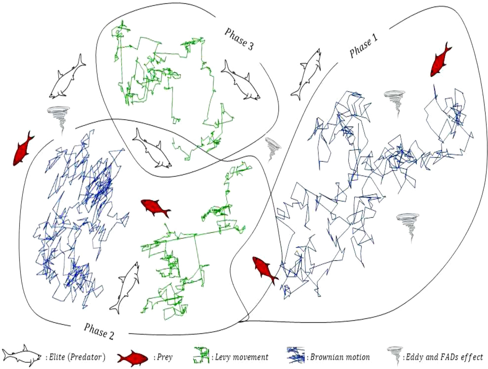
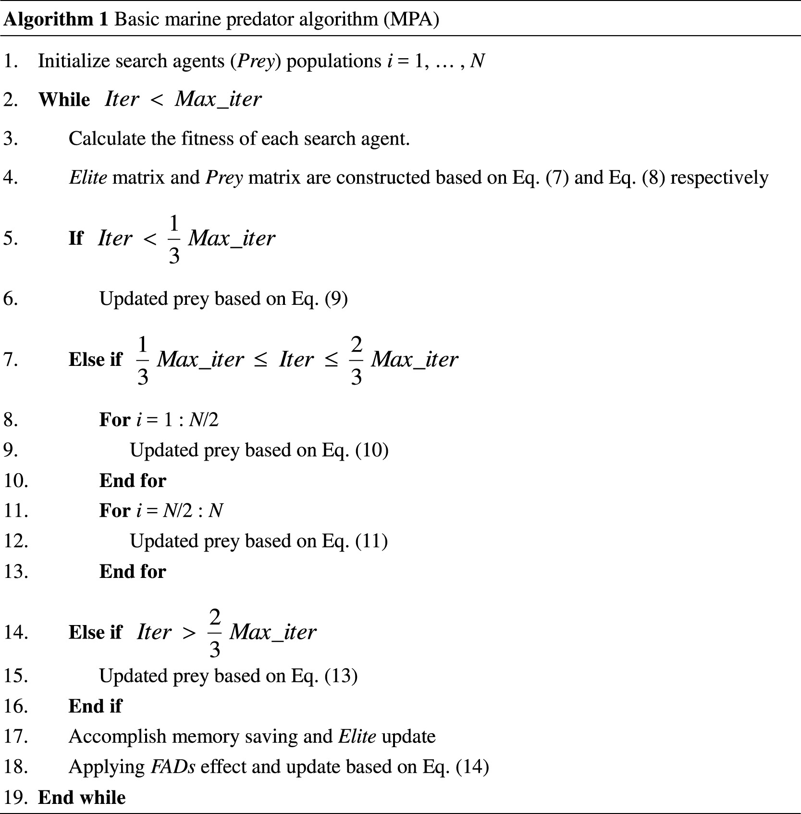
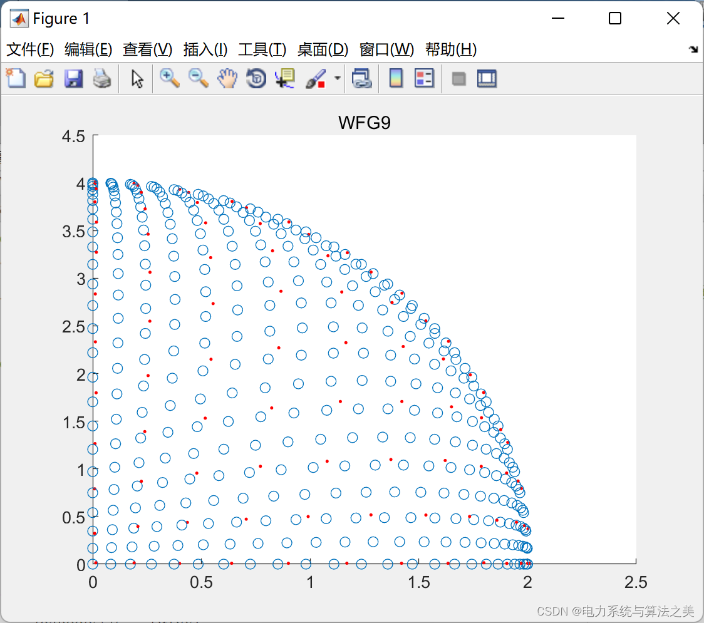
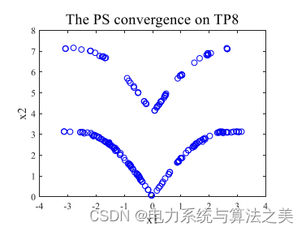
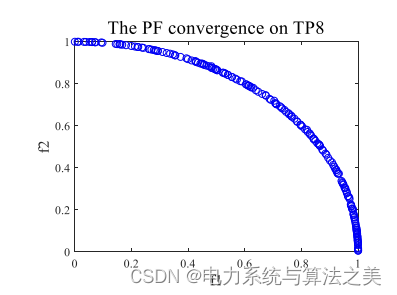
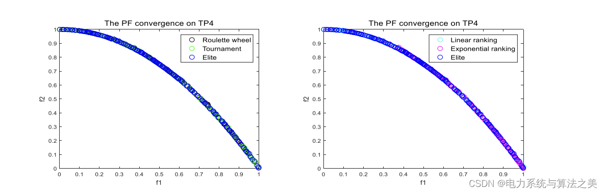
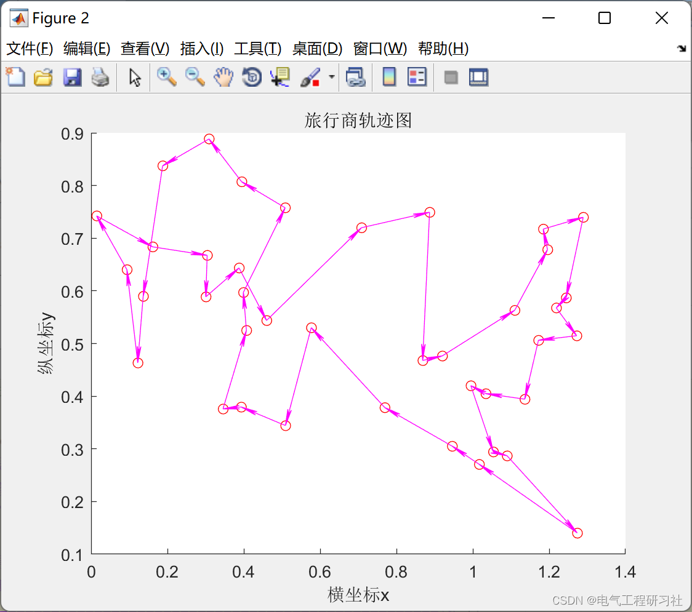
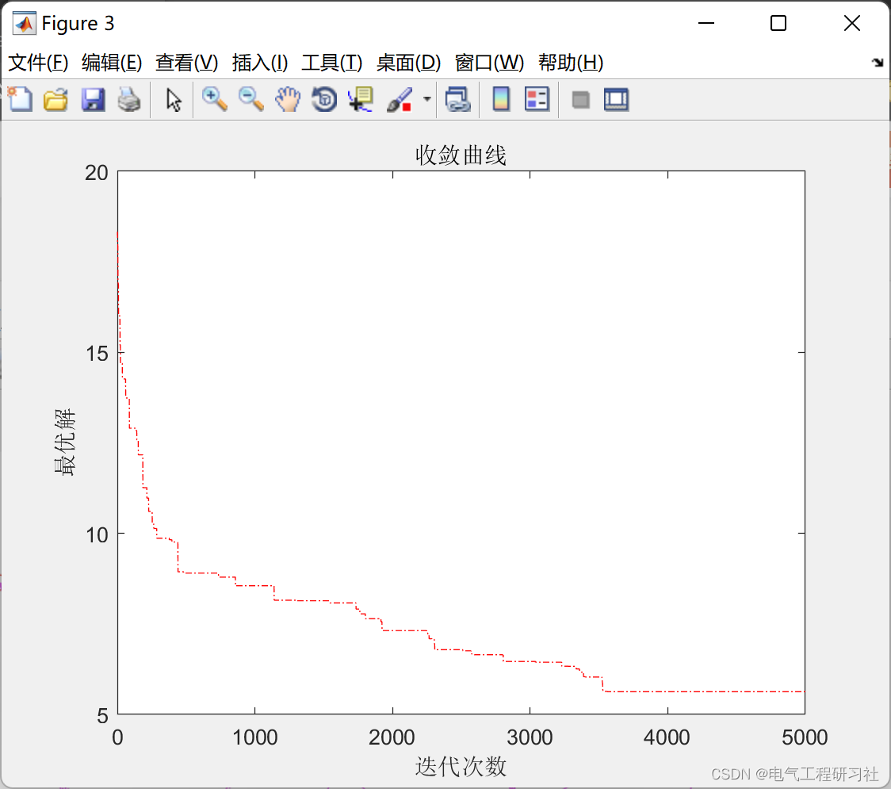
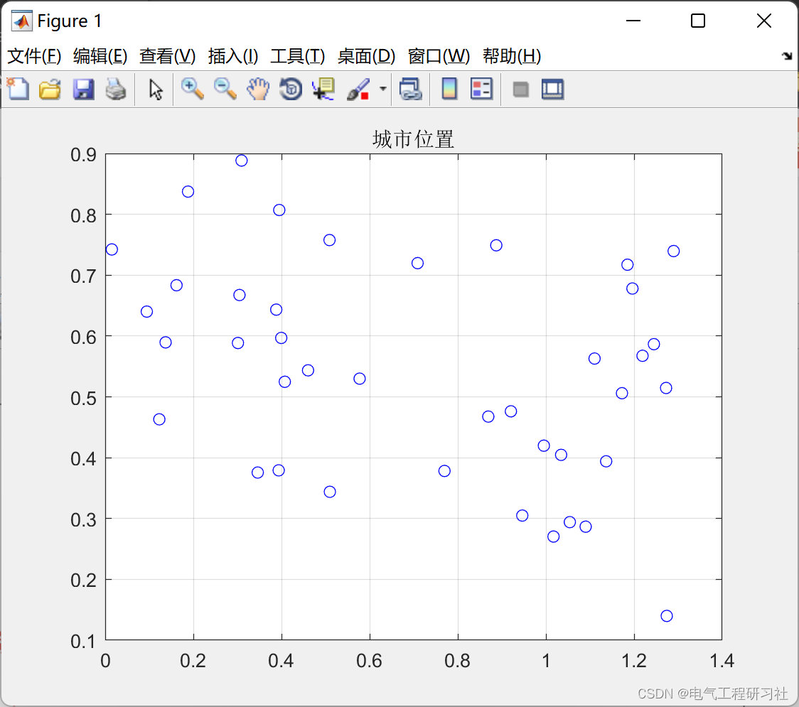

# Path Planning | Multi-Objective Ocean Predator Algorithm (MOMPA) Solve Shortest Path Problem (Matlab Code Implementation)

Explaination:
Path Planning | Multi-Objective Ocean Predator Algorithm (MOMPA) Solving the Shortest Path Problem (Matlab Code Implementation)
1. Overview: This paper proposes the multi-objective version of the recently proposed Ocean Predator Algorithm (MPA), called Multi-Objective Ocean Predator Algorithm (MOMPA). In this algorithm, an external archive component is introduced to store the non-dominant Pareto optimal solutions found so far. Based on the elite selection method, a top predator selection mechanism is proposed, selecting effective solutions from the archive as top predators to simulate the foraging behavior of predators. The performance of the proposed algorithm was evaluated using the CEC2019 Multi-Modal Multi-Objective Benchmark Functions and compared with nine state-of-the-art multi-objective metaheuristic algorithms. Additionally, seven multi-objective engineering design problems (Side Impact Problem, Gear System Design Problem, Welded Beam Design Problem, Pulley Design Problem, Two Trusses Design Problem, Spring Design Problem, and Cantilever Beam Design Problem) were further validated to demonstrate the effectiveness of the proposed MOMPA algorithm. The results indicate that the proposed MOMPA algorithm not only provides very competitive results but also outperforms other algorithms.
Compared to single-objective optimization, the greatest advantage of multi-objective optimization is the ability to simultaneously address multiple conflicting objectives and obtain a set of Pareto optimal solutions. The solution set contains more effective information, providing decision makers with additional reference data. Single-objective algorithms corresponding to multi-objective algorithms have also developed accordingly. The main reason for this is that single-objective algorithms face numerous obstacles in solving complex multi-objective problems. The Marine Predator Algorithm (MPA) is a recently proposed algorithm based on group intelligence by Faramarzi et al. The algorithm simulates the hunting behavior of marine predators, where the predator adopts an optimal foraging strategy based on the encounter rate with prey. The MPA algorithm features few parameters, fast computation speed, and high accuracy. Currently, there is no multi-objective version available, thus it could be considered for conversion into a multi-objective version to solve multi-objective optimization problems. Various multi-objective optimization algorithms are listed in literature, but according to the NF theorem, no algorithm can solve all optimization problems logically, hence researchers develop new algorithms or enhance the performance of existing ones. This theorem is not only applicable to single-objective optimization algorithms but also to multi-objective optimization algorithms. This is also the motivation behind this work. Based on the Marine Predator Algorithm, a new multi-objective optimization algorithm, namely Multi-Objective Marine Predator Algorithm (MOMPA), is proposed.
2. Marine Predator Algorithm
This paper is structured as follows: 1. The archive component is integrated into the MPA to store non-dominant Pareto optimal solutions discovered so far. 2. A top predator selection mechanism is proposed, selecting the solution with the least number of adjacent solutions from the archive and determining it as a guide for the group search. 3. By using the two components above, a multi-objective version of the MPA is proposed. 4. The performance of MOMPA is evaluated using the CEC2019 multi-objective test suite and seven engineering design problems, and compared with several state-of-the-art multi-objective algorithms. The remainder of this paper is organized as follows: Section 2 introduces the basic concepts of multi-objective optimization problems and related research work in the field of multi-objective optimization. Section 3 introduces the Ocean Predator Algorithm and proposes a Multi-Objective Ocean Predator Algorithm. Section 4 introduces the Multi-Objective Ocean Predator Algorithm. Section 5 presents the results and discussion. In Section 6, seven engineering examples are used to test the performance of MOMPA. Additionally, the experimental results are analyzed in Section 7. Finally, Section 8 summarizes future work and outlook. Recently, Faramarzi et al. proposed a new efficient metaheuristic algorithm called the Ocean Predator Algorithm. This algorithm mimics the behavior of ocean predators, which use Levy and Brownian motion as their best hunting mechanisms for preying on prey. The hunting behavior of predators is divided into three stages based on the speed ratio between predator and prey, with Levy and Brownian motion alternating in these three stages. Figure 1 shows a schematic diagram of the predator's three-stage hunting. When the speed ratio v between predator and prey is very small, equal to 0.1, the predator's best hunting strategy is Levy motion, regardless of whether the prey is moving Levy or Brownian motion. This stage is the exploration phase of the algorithm. When v approximates to 1, the speed of the predator and prey is equal. If the prey moves Levy steps, then the predator moves Brownian steps. When the speed ratio v is greater than 10, the predator's best hunting strategy is to remain stationary, regardless of how long the prey's steps are.
​  
Editor
Figure 1. Three-stage foraging process
Ocean predators have strong memory, allowing them to remember the location of each successful prey capture. This process is achieved through storage in MPA. After iteration, each solution is compared with the current best solution; if a better solution exists, it replaces the current best solution. The algorithm flow of MPA is shown in Algorithm 2.
​  
Editor
Mathematical Model:
Detailed mathematical models and explanations are provided in Part 4.
3. Numerical Experiments in Matlab Part
Editor
Editor
4. Matlab code and detailed explanation of the article
The complete code and detailed article can be found here: Multi-Object Marine Predator Algorithm (MOMPA) (Matlab Code)
References
[1] X. Zhang, Y. Tian, R. Cheng, and Y. Jin, An efficient approach to  
nondominated sorting for evolutionary multiobjective optimization, IEEE  
Transactions on Evolutionary Computation, 2015, 19(2): 201-213.  
[2] X. Zhang, Y. Tian, R. Cheng, and Y. Jin, A decision variable  
clustering based evolutionary algorithm for large-scale many-objective  
Optimization, IEEE Transactions on Evolutionary Computation, 2018, 22(1):  
97-112.  
5 Multi-objective Ocean Predator Algorithm (MOMPA) for Traveling Salesman Problem 5.1 Traveling Salesman Problem Knowledge: This blog summarizes it in detail: Operations Research - Graph Theory and Shortest Paths  
5.2 Run Results Editing  
Editing  
Editing  
5.3 MATLAB Code Implementation: Only a part of the code is shown here, all codes can be found in:  
Included in the fourth section:  
Editing  
Then the code has detailed comments:
function Draw_Path(Path, X)
​  

## Images

<!-- PAYMENT_BLOCK -->

## Get this dataset

- Payment link (Stripe): [Buy now](https://buy.stripe.com/3cs8yP7sY87d0vu9AB)
- Payment QR code: 

<!-- /PAYMENT_BLOCK -->
